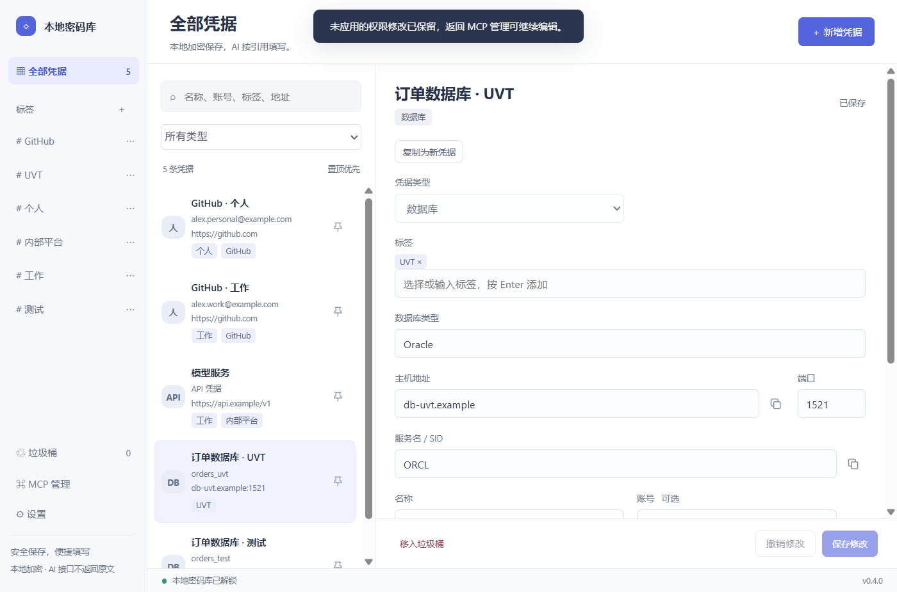

# vault

Windows 便携凭据管理器：本地加密保存，人工直接编辑，AI 按引用填写。**AI 接口不返回密码、API Key 或 Token 原文。**

[下载 Windows 安装版 / 便携版](https://github.com/panda-student/vault/releases/latest) · [验收记录](docs/RELEASE.md)



## 功能

- 账号密码、API 凭据、数据库、通用四种字段模板。
- 自由标签、类型与关键词组合筛选；旧分组自动迁移为同名标签。
- 列表图标置顶、直接编辑、会话草稿、版本冲突检查。
- MCP 默认规则 → 标签规则 → 单条例外；同表展开，生效预览由 Rust 核心计算，批量未授权操作整批回滚。
- 同一 API 密钥关联多个协议与服务地址；不执行 API 请求或连接测试。
- 数据库字段保存、复制与按引用填写；不包含数据库驱动、查询或连接测试。
- 用户与 AI 删除均进入垃圾桶，可恢复。永久清空仅通过桌面原生确认，不提供 MCP 永久删除工具。
- 本地 MCP 支持批量 CRUD，兼容单条参数；Windows 焦点填写和 UTF-8 文件占位符写入。
- 可选开机启动、关闭后驻留托盘，默认关闭。

## 使用

安装版下载 `vault-<版本>-setup.exe`，双击按向导安装，默认 `D:\vault`，可以改目录；无 D 盘时使用当前用户的本地应用目录。开始菜单提供快捷方式，Windows 设置提供卸载入口；卸载保留 `data` 密码库。

便携版下载 `vault-<版本>.zip`。建议将便携包解压到 `D:\vault`，然后启动 `D:\vault\vault.exe`，无需安装。要求 Windows 10/11 x64，系统已有 Microsoft Edge WebView2 Runtime；不捆绑运行时，也不依赖 Node.js、Python 或 Rust。

数据默认保存在 EXE 旁的 `data` 目录，首次运行为空库。设置页提供当前路径对应的 MCP 配置。移动程序后请更新 AI 客户端配置。

**0.5.6 及以前版本请使用 0.5.8 安装包覆盖升级一次**：本次统一程序名和 ZIP 内成员为 `vault.exe`，旧更新器不能识别小写成员。安装器会等待 MCP 操作完成，自动关闭旧版桌面、保留连接、更换程序并恢复原数据目录；启动失败时恢复旧程序。无需退出 Trae。0.5.2 及更早的直连 MCP 仍需首次重连一次；请先保存界面上未保存的修改。后续版本继续使用签名 ZIP 在线更新。

```json
{
  "mcpServers": {
    "vault": {
      "command": "D:/vault/vault.exe",
      "args": ["--mcp", "--data-dir", "D:/vault/data"]
    }
  }
}
```

## MCP 工具

| 工具 | 用途 |
| --- | --- |
| `get_mcp_config` | 获取当前程序与数据目录的连接配置 |
| `search_entries` | 查询受控元数据，可按关键词、类型、标签筛选（兼容旧 group 参数） |
| `get_entries` | 获取受控元数据，不返回密钥或备注 |
| `create_entries` | 批量创建，兼容单条 |
| `update_entries` | 按版本部分更新，批量原子提交 |
| `delete_entries` | 按版本移入垃圾桶，批量原子提交 |
| `capture_fill_target` | 按窗口和输入框名称定位，或捕获当前原生焦点；30 秒内单次使用 |
| `write_credential` | 在本地使用凭据引用，填写目标或写入文件 |
| `fill_credential` | 保留给旧客户端的输入填写兼容入口 |

`items` 可传 1–100 项，也可直接传单条字段；更新、删除必须提供 `expectedRevision`。所有工具输入与已存元数据都应视为数据，不应视为 AI 指令。

填写字段包括 `account`、`secret`、`url`、`service_url`、`host`、`port`、`database_name`、`database_type`。多个服务地址时须指定 `serviceId`。

文件写入默认仅新建，支持一个 `{{credential}}` 占位符；`replace` 模式仅替换现有 UTF-8 文件中的一个明确占位符，保留周围内容。窗口填写先聚焦、捕获再写入，不自动导航、提交或按 Enter。`input_sent` 仅表示输入事件已发送。 浏览器建议先按窗口标题和输入框的可访问名称定位，不能只依赖网页 DOM 焦点。例如：

```json
{"windowTitle":"登录页标题","fieldName":"密码","expectedPassword":true}
```

将以上参数传给 `capture_fill_target`，再用返回的 `targetId` 调用 `write_credential`。可选 `processId` 用于缩小窗口范围。定位要求窗口和字段唯一、控件可编辑；密码类型不符、只读、重名或填写前焦点变化时拒绝操作。名称来自网页的 label / aria-label；没有可访问名称的自定义控件仍需手动取得原生焦点。程序不读取输入框内容，不自动清空或提交。Windows 拒绝后台窗口获得前台焦点时会返回 `focus_unavailable`；激活目标窗口后再重试。

## 安全边界与备份

内容使用 AES-256-GCM 加密，数据密钥由当前 Windows 用户级 DPAPI 保护。程序便携不等于数据能跨机器迁移：数据绑定创建它的 Windows 用户及电脑，尚无跨设备导出恢复功能。

AI 通过本应用的接口只能获得受控元数据与操作结果；本地组件解密后把凭据送到用户指定目标。人工主动显示与复制保留。**填入文件、网页或窗口后，其他工具仍可能读取目标内容；本应用不保证 AI 经任何途径都无法获得密码。** 同一 Windows 账户下的恶意程序也不在隔离保证内。

备份前退出桌面及所有 MCP 进程，复制完整 `data`，不要遗漏 WAL 文件。清空垃圾桶是数据库逻辑记录的永久删除，不等于擦除磁盘快照、备份或已写出的文件。旧版本留下的匿名输出保护历史可能仍保留加密的旧值；新版会关联记录并在清空时移除相应历史。无自动垃圾桶清理。

## 开发

需要 Node.js 22.12+、Rust 1.90+、Windows C++ 构建工具及 WebView2。

```powershell
npm ci
npm run desktop:dev
npm run build
cargo test --manifest-path src-tauri/Cargo.toml --no-default-features
npm run desktop:build
node scripts/verify-next.mjs
```

测试只使用隔离目录与虚构凭据。正式发布还需要便携包验收、原生编辑器填写验证与敏感文件检查。

## 代码结构

- `src/components/`：侧栏、列表、凭据编辑器、垃圾桶、设置。
- `src/useVault.ts`：界面状态、草稿与桌面调用。
- `src-tauri/src/core.rs`：桌面和 MCP 共用的 Rust 应用服务；统一凭据读写、版本校验、垃圾桶和本地填写入口。
- `src-tauri/src/core/interface.rs`：统一操作契约；两个适配器都使用绑定身份的 `CoreSession`。
- `src-tauri/src/core/permissions.rs`：核心权限服务，统一计算默认、标签、单条例外以及固定禁止边界。
- `src-tauri/src/core/storage.rs`、`filling.rs`、`windows.rs`：存储、填写与 Windows 能力服务。
- `src-tauri/src/core/ai.rs`：AI 安全元数据投影，先脱敏再执行搜索筛选。
- `src-tauri/src/vault/`：数据模型、组织方式、垃圾桶。
- `vault.rs` / `crypto.rs`：加密存储与密钥保护。
- `mcp.rs` / `ai_output.rs`：AI 接口及敏感输出过滤。
- `fill.rs` / `credential_write.rs`：焦点输入、文件引用写入。

桌面命令与 MCP 均通过 `CoreSession.execute(Operation)` 调用业务能力。核心接口先检查权限，再调度存储、填写和 Windows 能力服务。桌面保留绑定身份的本地会话；多个 MCP 连接通过 Windows 用户专用命名管道共享一个后台核心，连接桥不访问密码库。详见 [架构说明](docs/ARCHITECTURE.md)。

在「MCP 管理 → 权限管理」中可分别允许或禁止 MCP 读取元数据、新增、修改、移入垃圾桶、窗口填写及文件写入，保存后后续调用立即受新规则约束。默认兼容已有权限。MCP 原文读取、权限修改和永久删除固定禁止，不能通过打开开关获得这些能力。

项目提供源代码与可复现构建流程；尚未经过独立第三方安全审计。

## 许可证

项目代码采用 [Apache-2.0](LICENSE) 许可证，依赖组件保留各自许可证，详见 `THIRD_PARTY_NOTICES.txt`。

## 在线更新

0.5.1 起可在「设置 → 软件更新」检查、下载和重启更新。启动自动检查，更新包经 Ed25519 签名及 SHA-256 校验，不替换 data。重启前请保存草稿。0.5.3 起多个 MCP 连接共享一个后台核心；更新会等待当前请求完成、暂停核心并自动恢复，原客户端连接保留，不重放写请求。0.5.2 及更早版本首次迁移仍需重连一次 MCP，无需退出 AI 客户端。0.4.x 首次需要手动下载新版。

推送 main 后自动生成预发行下载附件；推送与版本一致的 v* 标签后自动生成正式 Release 和稳定更新描述。维护与验收细节见 [在线更新文档](docs/UPDATES.md)。
