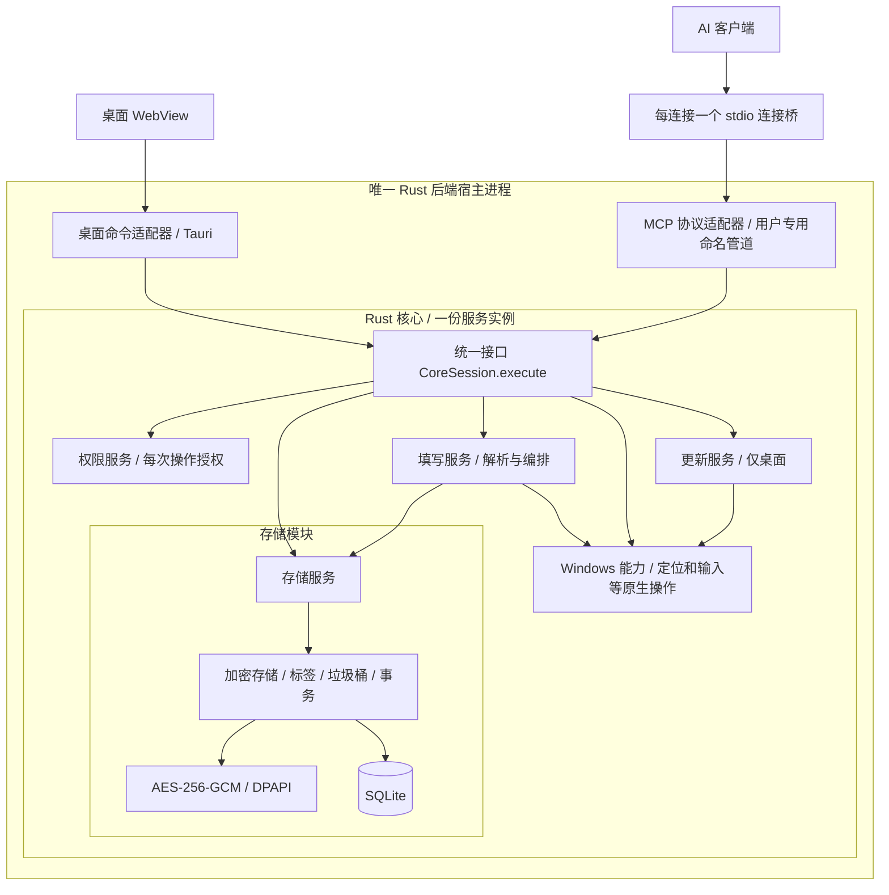

# 现有实现：统一操作接口与五个核心服务

同一 Windows 用户、同一 EXE 路径与规范化密码库目录，只启动一个 Rust 后端宿主。桌面 WebView 通过 Tauri 命令适配器调用它；AI 客户端通过轻量 stdio 连接桥、用户专用命名管道和 MCP 适配器调用它。宿主在打开密码库前取得唯一服务锁，重复的桌面启动只激活已有宿主，不再创建另一套核心。MCP 先启动时宿主不创建 WebView，之后打开桌面在同一宿主内创建窗口。历史 `--mcp-service` 启动参数继续兼容，但现在启动的是同一个通用后端宿主；对应实现位于 `backend.rs`，不再有专供 MCP 的第二套核心。

宿主只打开一次核心。桌面与 MCP 的 `CoreSession` 身份不同，但共享同一个 `Arc<CoreService>`、执行门、填写目标、输出保护状态和更新运行锁。MCP 会话只能由宿主创建为受限身份，协议请求不接受调用者身份字段。




箭头表示模块调用依赖，不表示串行数据流。接口层先调用权限服务，通过后才分发业务操作；权限服务不执行存储或填写。

## 分层与职责

| 层 / 模块 | 实现 | 职责 |
| --- | --- | --- |
| 表现层 | `src/components/`、`src/useVault.ts` | 界面、草稿、标签与权限矩阵 |
| 桌面适配器 | `main.rs` | 将 Tauri 命令转换为统一操作，组装窗口、托盘和剪贴板 OS 端口 |
| 后端宿主 | `backend.rs` | 唯一宿主服务锁、MCP 监听、桌面激活、连接排空和空闲退出 |
| MCP 连接适配器 | `mcp_bridge.rs`、`mcp_bridge/` | 保留 stdio 连接、连接唯一共享核心、等待请求完成并暂停/恢复；不访问凭据 |
| MCP 适配器 | `mcp.rs`、`ai_output.rs` | 共享核心中的协议会话、参数与单条/批量格式转换，过滤协议帧 |
| 核心接口 | `core.rs`、`core/interface.rs` | 绑定调用身份，接收统一操作，先鉴权再调度，按身份生成返回结果 |
| 权限服务 | `core/permissions.rs` | 默认权限、标签规则、单条例外、MCP 总开关及固定边界；工具发现和操作执行使用同一策略 |
| 存储服务 | `core/storage.rs`、`core/ai.rs` | 凭据业务、版本校验、标签、垃圾桶和 AI 安全元数据投影 |
| 填写服务 | `core/filling.rs`、`core/filling/write.rs` | 解析凭据引用、处理文件模板与冲突检测，通过 Windows 服务执行原生操作 |
| 更新服务 | `core/updater.rs` | 签名版本、下载、完整性校验、安装编排与失败回退 |
| Windows 能力服务 | `core/windows.rs`、`core/windows/input.rs`、`core/windows/input/locator.rs`、`core/windows/installer.rs` | 维护一次性输入目标，执行 UIA 定位、SendInput、原子文件替换、启动设置、原生确认、剪贴板与进程操作 |
| 底层实现 | `vault.rs`、`vault/`、`crypto.rs`、`fill.rs`（输入协议类型）、`startup.rs` | 加密存储、事务、文件和系统输入等实现细节 |

`CoreService` 和服务模块不向适配器开放。适配器只持有身份已绑定的 `CoreSession`。核心的 `Caller` 不可由请求反序列化；`Operation` 也不包含可由客户端填写的调用身份。唯一宿主先绑定桌面会话，再派生只能降权为 MCP 身份的会话；两者持有同一份核心服务，MCP 不能获得桌面会话。

## 统一接口与返回规则

两个入口使用相同的 `Search`、`Read`、`Create`、`Update`、`Delete` 操作。桌面单条操作转换为长度为一的输入数组；MCP 继续兼容单条字段和 `items`，格式转换由适配器完成。

同一 `Read` 操作，桌面获得界面所需字段，MCP 只获得受控元数据，排除秘密和备注。MCP 修改操作由核心直接返回 ID、版本和状态，不能靠适配器决定是否隐藏已存字段。搜索先脱敏再匹配，避免通过搜索结果推断秘密。协议出口仍过滤完整帧，包括 SDK 错误。

人工显示与复制使用核心 `ReadField` / `CopyField` 操作并核对版本；MCP 身份即使直接调用这些操作也会被拒绝。系统剪贴板由桌面注入 `ClipboardPort`，长度校验、权限和业务调度在 Windows 能力服务及统一接口中完成。

## 六组 MCP 权限

在「MCP 管理 → 权限管理」的矩阵中配置，默认七列均开启（允许访问，加下列六类操作）：

| 权限 | 对应操作 |
| --- | --- |
| 读取元数据 | 搜索、按 ID 读取受控信息 |
| 新增凭据 | 新增单条或批量凭据 |
| 修改凭据 | 更新单条或批量凭据 |
| 移入垃圾桶 | 核对版本后逻辑删除 |
| 填写到窗口 | 捕获目标、填写及旧版填写兼容入口 |
| 写入文件 | 新建文件或替换明确占位符 |

窗口填写与文件写入分别鉴权，共享的 `write_credential` 按真实目标类型判断。两项都关闭时，该工具不再列出。配置查询不属于这六组，但仍受 MCP 总开关控制。

每次工具发现和操作执行都读取最新持久化设置，已建立连接的后续调用立即受新策略约束；正在执行的已授权操作不追溯撤销。客户端若缓存工具清单，可能需要刷新清单，但旧清单中的调用仍会被核心拒绝。

权限修改、原文读取、系统剪贴板、启动设置、垃圾桶查看、永久删除和在线更新固定不对 MCP 开放。MCP 的恢复、置顶和标签管理沿用修改权限及对象范围校验。关闭总开关会拒绝全部后续 MCP 操作。默认六组权限均开启，以兼容已有行为；旧设置缺少权限字段时按该默认值读取，保存时写入新结构。

永久清空由核心收集垃圾桶快照，调用 Windows 服务显示原生确认框（默认取消），确认后核验快照再删除。既不能传一个 `confirmed=true` 绕过，也不能通过 MCP 调用该操作。

存储层调用加密再执行 SQL；加密模块不负责存数据库。ID、版本、时间等结构元数据保持可查询，凭据内容加密保存。填写服务内部使用同一存储服务中的密码库。Windows 能力服务不持有密码库；输入方法接收延迟解析回调，先验证目标，再解析凭据，输入前再次核对焦点。原来的目标有效期、一次性消费、按键缓冲清零与秘密清零保持不变。文件模板、占位符、冲突检测与暂存文件清理属于填写服务，`ReplaceFileW` 由 Windows 能力服务封装。DPAPI 绑定和数据库版本保持原有约定。

## 验证

```powershell
cargo test --manifest-path src-tauri/Cargo.toml
npm run desktop:build
npm run verify:permissions
npm run verify:integration
node scripts/verify-write.mjs
```

核心测试直接使用 MCP 身份调用仅限桌面的操作，证明误路由也被拒绝，并覆盖六组权限、撤销/恢复、跨会话可见性、版本冲突、删除后禁止填写和返回投影。

原生 WebView2 测试实际勾选默认权限矩阵并保存并检查持久化、恢复、命中和窄窗口布局。MCP 线路测试使用保持连接的真实 stdio 客户端；在隔离密码库中注入持久化策略变更，模拟另一个桌面进程保存权限，验证工具发现和执行同步受约束。所有测试均使用临时目录与虚构凭据。

## 标签与对象权限

默认只显示默认规则；「按标签单独设置」展开同一表格中的标签，再展开标签显示对应凭据。展开、收起仅改变显示，不改变授权。无标签凭据也可配置单条例外；同一凭据出现在多个标签下时，共用同一个 ID 的规则。

每项操作单独计算：单条显式设置优先；多个标签的显式规则冲突时禁止优先；没有显式规则则继承默认。允许访问与具体操作同时通过才可执行。MCP 总开关和固定禁止边界优先于所有对象规则。

生效预览调用核心 `PermissionPreview`，不是在 Vue 中另写一套授权算法。该操作只允许桌面身份调用，不向 MCP 暴露。标签、单条规则以 AES-GCM 加密后保存，规则键不会以明文落到 SQLite 或 WAL。标签改名/删除同步更新活动条目、垃圾桶、标签目录和规则，使用同一事务。

搜索先按对象权限过滤，再对元数据脱敏后匹配。批量读含未授权对象时拒绝整批。批量新增、更新、移入垃圾桶在 SQLite 写事务内部读取当前规则并检查所有对象；任何一项失败则回滚。修改前后的范围都需授权；MCP 不能通过修改标签给自身增加权限。单条创建按拟创建条目的标签计算，不支持单条 ID 创建规则。

## 数据升级

v3 格式把旧分组迁移为同名标签并去重，原账号、密码、地址、数据库字段、备注和垃圾桶状态保留。旧 `group` 输入作为兼容别名转为标签，旧分组筛选参数按标签匹配；界面不再提供独立分组。

已有 v1/v2 数据库升级前通过 SQLite `VACUUM INTO` 生成一致的加密备份，位于数据目录的 `backups/before-tags-permissions-*.db`。迁移在事务中完成，重新打开不会重复修改已迁移条目的版本。旧全局权限的显式配置继续保留；新密码库默认全部允许。
## 在线更新

更新操作通过统一 Operation 接口，在核心被固定为 DesktopOnly。更新服务编排检查、下载与验签，Windows 能力服务执行进程启动。只有唯一后端持有核心运行锁，更新需取得独占锁。详细发布协议、数据保护、失败回退和验证边界见 [UPDATES.md](UPDATES.md)。

## 更新期间的 MCP 生命周期

更新协调按 EXE 路径覆盖所有相关连接和数据目录。连接桥先拒绝新请求并等待已有请求完成，关闭内部管道；后端确认所有 MCP 连接排空后确认暂停。没有桌面窗口的宿主退出并释放运行锁；有窗口的宿主保留桌面，供安装器自动关闭、替换并重启。原 stdio 连接桥保持不变，升级成功或回退后恢复协议握手；写请求不重放。

在线更新在取得核心独占执行门之前先排空 MCP，避免已排队请求等待同一个执行门造成死锁。界面关闭时，如果还有 MCP 连接，后台继续运行；重新打开界面复用原宿主。没有界面和客户端时，宿主空闲 5 秒后退出。明确的托盘退出和更新重启会退出当前宿主；仍在线的连接桥按原机制重连并按需启动后台。

命名管道限定当前用户和系统账户，拒绝远程连接。桌面二次启动使用独立的激活通道，只接受同用户、同 EXE 的进程发送 `show` 或 `background`；不接受操作、身份、路径或凭据载荷。MCP 的业务请求始终进入固定 MCP 身份的适配器。

## 浏览器填写目标（0.5.6）

`CaptureTarget(CaptureRequest)` 和填写操作均先经过核心权限服务，再进入填写服务。`core/windows/input/locator.rs` 仅在本地按窗口标题、可选进程 ID 和输入框可访问名称定位唯一 Edit 控件，检查密码类型、可编辑性后取得原生焦点；不会读取控件值。UIA 查询有超时和并发限制，工作线程仅定位和聚焦，不持有或输入凭据。

定位成功返回 30 秒有效的一次性目标。实际写入仍由`core/windows/input.rs` 完成：解密前后校验前台窗口、原生焦点及 UIA Runtime ID，不符合就拒绝。无参数捕获继续兼容记事本、编辑器、终端等原生焦点路径。`input_sent` 只表示系统接收了键盘事件；浏览器验收单独检查实际 DOM 值及可信输入事件，不能把事件发送当成网页填写成功。

## 图中的包含关系

最外层边框是唯一 Rust 后端进程，包含桌面适配器、MCP 适配器和 Rust 核心。核心边框包含统一接口、权限服务、存储、填写、Windows 能力和更新服务。存储模块再包含加密密码库实现。客户端和 stdio 连接桥位于宿主边框外；箭头表示调用，不代表包含。

## 安装和更新的私有启动入口

`main.rs` 在普通核心会话建立前分流 `--installer-replace` 和 `--apply-update`，分别进入 `core/installer.rs` 与 `core/updater.rs` 的启动编排。这些入口用于程序文件替换、回退和重启，不是 MCP 工具，也不通过普通 `Operation` 接口。Windows 进程操作仍位于 `core/windows/`。安装器只把 `vault.desktop` 主窗口类和已发布版本使用的 `Tauri Window` 视为桌面窗口，再核对同用户、同 EXE 路径及进程创建时间；COM、IME 和无窗口事件目标不进入重启列表。

交互架构图保存在 `docs/prototypes/architecture.html`，源规格为同目录的 `architecture.json`。图中的统一核心同时表示代码复用和运行时共享：桌面与 MCP 在同一宿主中持有身份隔离的会话，共享一份核心服务实例。

## 单后端实测

先运行 `node scripts/tauri.mjs build --debug --no-bundle`，再运行 `node scripts/verify-unified-backend.mjs`。它在隔离目录启动实际 Tauri WebView 与两个 MCP 客户端，分别验证桌面先启动和 MCP 先启动、唯一后台 PID、双向读写、实时权限撤销与恢复、激活通道拒绝其他进程、关闭和重开窗口不重建后台。报告为 `artifacts/unified-backend-verification.json`。调试端口仅存在于显式指定端口的 debug 构建，正式版没有该入口。
