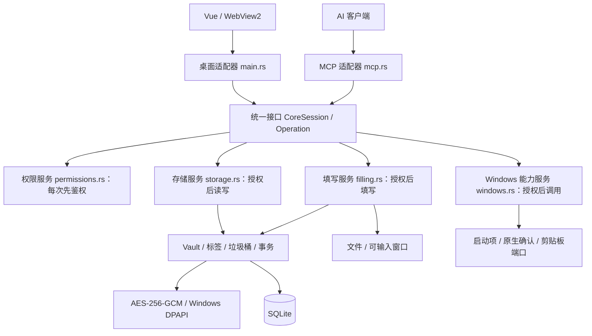

# 统一操作接口与四个核心服务

桌面模式与 `--mcp` 模式都通过 `CoreSession.execute(Operation)` 进入核心，`call<T>` 只是执行后将结果转换为类型的便捷方法。每个进程拥有自己的会话与服务实例，共用代码和数据目录。



箭头表示模块调用依赖，不表示串行数据流。接口层先调用权限服务，通过后才分发业务操作；权限服务不执行存储或填写。

## 分层与职责

| 层 / 模块 | 实现 | 职责 |
| --- | --- | --- |
| 表现层 | `src/components/`、`src/useVault.ts` | 界面、草稿、标签与权限矩阵 |
| 桌面适配器 | `main.rs` | 将 Tauri 命令转换为统一操作，组装窗口、托盘和剪贴板 OS 端口 |
| MCP 适配器 | `mcp.rs`、`ai_output.rs` | 协议、参数与单条/批量格式转换，过滤协议帧 |
| 核心接口 | `core.rs`、`core/interface.rs` | 绑定调用身份，接收统一操作，先鉴权再调度，按身份生成返回结果 |
| 权限服务 | `core/permissions.rs` | 默认权限、标签规则、单条例外、MCP 总开关及固定边界；工具发现和操作执行使用同一策略 |
| 存储服务 | `core/storage.rs`、`core/ai.rs` | 凭据业务、版本校验、标签、垃圾桶和 AI 安全元数据投影 |
| 填写服务 | `core/filling.rs` | 持有输入目标，协调本地引用解析与窗口/文件填写 |
| Windows 能力服务 | `core/windows.rs` | 启动设置、原生永久删除确认、剪贴板校验与端口调用 |
| 底层实现 | `vault.rs`、`vault/`、`crypto.rs`、`credential_write.rs`、`fill.rs`、`startup.rs` | 加密存储、事务、文件和系统输入等实现细节 |

`CoreService` 和服务模块不向适配器开放。适配器只持有身份已绑定的 `CoreSession`。核心的 `Caller` 不可由请求反序列化；`Operation` 也不包含可由客户端填写的调用身份。启动组装代码根据进程模式绑定桌面或 MCP 身份，会话不能切换身份。

## 统一接口与返回规则

两个入口使用相同的 `Search`、`Read`、`Create`、`Update`、`Delete` 操作。桌面单条操作转换为长度为一的输入数组；MCP 继续兼容单条字段和 `items`，格式转换由适配器完成。

同一 `Read` 操作，桌面获得界面所需字段，MCP 只获得受控元数据，排除秘密和备注。MCP 修改操作由核心直接返回 ID、版本和状态，不能靠适配器决定是否隐藏已存字段。搜索先脱敏再匹配，避免通过搜索结果推断秘密。协议出口仍过滤完整帧，包括 SDK 错误。

人工显示与复制使用核心 `ReadField` / `CopyField` 操作并核对版本；MCP 身份即使直接调用这些操作也会被拒绝。系统剪贴板由桌面注入 `ClipboardPort`，长度校验、权限和业务调度在 Windows 能力服务及统一接口中完成。

## 六组 MCP 权限

在「MCP 管理 → 权限管理」的矩阵中配置，默认七列均开启（允许访问，加下列六类操作）：

| 权限 | 对应操作 |
| --- | --- |
| 读取元数据 | 搜索、按 ID 读取受控信息 |
| 新增凭据 | 新增单条或批量凭据 |
| 修改凭据 | 更新单条或批量凭据 |
| 移入垃圾桶 | 核对版本后逻辑删除 |
| 填写到窗口 | 捕获目标、填写及旧版填写兼容入口 |
| 写入文件 | 新建文件或替换明确占位符 |

窗口填写与文件写入分别鉴权，共享的 `write_credential` 按真实目标类型判断。两项都关闭时，该工具不再列出。配置查询不属于这六组，但仍受 MCP 总开关控制。

每次工具发现和操作执行都读取最新持久化设置，已建立连接的后续调用立即受新策略约束；正在执行的已授权操作不追溯撤销。客户端若缓存工具清单，可能需要刷新清单，但旧清单中的调用仍会被核心拒绝。

权限修改、原文读取、系统剪贴板、启动设置、组织管理、垃圾桶查看/恢复和永久删除固定不对 MCP 开放。关闭总开关会拒绝全部后续 MCP 操作。默认六组权限均开启，以兼容已有行为；旧设置缺少权限字段时按该默认值读取，保存时写入新结构。

永久清空由核心收集垃圾桶快照，调用 Windows 服务显示原生确认框（默认取消），确认后核验快照再删除。既不能传一个 `confirmed=true` 绕过，也不能通过 MCP 调用该操作。

存储层调用加密再执行 SQL；加密模块不负责存数据库。ID、版本、时间等结构元数据保持可查询，凭据内容加密保存。填写服务内部使用同一存储服务中的密码库。DPAPI 绑定和数据库版本保持原有约定。

## 验证

```powershell
cargo test --manifest-path src-tauri/Cargo.toml
npm run desktop:build
npm run verify:permissions
npm run verify:integration
node scripts/verify-write.mjs
```

核心测试直接使用 MCP 身份调用仅限桌面的操作，证明误路由也被拒绝，并覆盖六组权限、撤销/恢复、跨会话可见性、版本冲突、删除后禁止填写和返回投影。

原生 WebView2 测试实际勾选默认权限矩阵并保存并检查持久化、恢复、命中和窄窗口布局。MCP 线路测试使用保持连接的真实 stdio 客户端；在隔离密码库中注入持久化策略变更，模拟另一个桌面进程保存权限，验证工具发现和执行同步受约束。所有测试均使用临时目录与虚构凭据。

## 标签与对象权限

默认只显示默认规则；「按标签单独设置」展开同一表格中的标签，再展开标签显示对应凭据。展开、收起仅改变显示，不改变授权。无标签凭据也可配置单条例外；同一凭据出现在多个标签下时，共用同一个 ID 的规则。

每项操作单独计算：单条显式设置优先；多个标签的显式规则冲突时禁止优先；没有显式规则则继承默认。允许访问与具体操作同时通过才可执行。MCP 总开关和固定禁止边界优先于所有对象规则。

生效预览调用核心 `PermissionPreview`，不是在 Vue 中另写一套授权算法。该操作只允许桌面身份调用，不向 MCP 暴露。标签、单条规则以 AES-GCM 加密后保存，规则键不会以明文落到 SQLite 或 WAL。标签改名/删除同步更新活动条目、垃圾桶、标签目录和规则，使用同一事务。

搜索先按对象权限过滤，再对元数据脱敏后匹配。批量读含未授权对象时拒绝整批。批量新增、更新、移入垃圾桶在 SQLite 写事务内部读取当前规则并检查所有对象；任何一项失败则回滚。修改前后的范围都需授权；MCP 不能通过修改标签给自身增加权限。单条创建按拟创建条目的标签计算，不支持单条 ID 创建规则。

## 数据升级

v3 格式把旧分组迁移为同名标签并去重，原账号、密码、地址、数据库字段、备注和垃圾桶状态保留。旧 `group` 输入作为兼容别名转为标签，旧分组筛选参数按标签匹配；界面不再提供独立分组。

已有 v1/v2 数据库升级前通过 SQLite `VACUUM INTO` 生成一致的加密备份，位于数据目录的 `backups/before-tags-permissions-*.db`。迁移在事务中完成，重新打开不会重复修改已迁移条目的版本。旧全局权限的显式配置继续保留；新密码库默认全部允许。