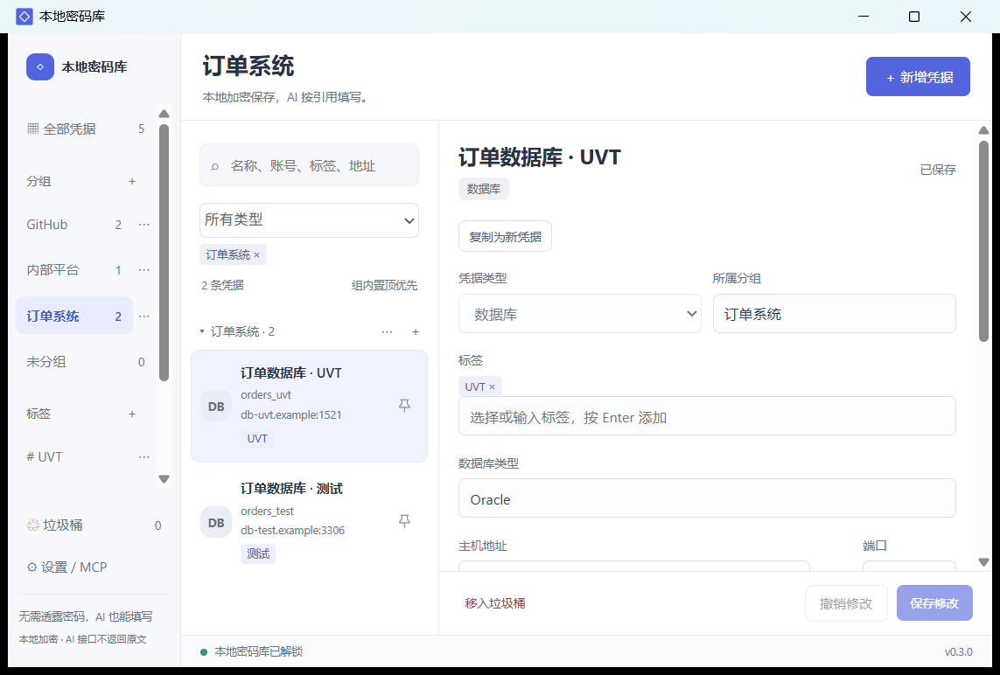

# 0.3.0 release verification

Verified on Windows with system WebView2 using isolated databases and synthetic credentials.

- Rust unit tests: 18 passed, including encryption, transactions, organization rename, trash restore and purge snapshot checks.
- MCP and desktop integration: 21 checks passed; native WebView2 suite: 73 checks passed (includes actual hit-target checks).
- Native confirmation: cancel and confirm exercised; default action is cancel.
- Native Notepad / PowerShell ISE / file writes: 20 checks passed. Independently saved files matched the synthetic credential and retained surrounding text.
- Legacy schema migration: 6 checks passed; old IDs, revisions, service IDs, URLs and secret preserved; old REST protocols normalized to custom.
- ZIP extracted into an isolated directory; packaged executable reran MCP, desktop and native editor verification.
- The public source file set was rebuilt with npm ci and npm run build; Rust tests passed from that source copy.

## Artifacts

- EXE: 5,476,864 bytes
- Complete extracted package including licenses and third-party source archives: 6,337,929 bytes
- ZIP: 2,748,837 bytes
- EXE SHA-256: `fe1075f3195849600b3164e880f160f9b4140c81da3073468dc7a4a2ef2ea707`
- ZIP SHA-256: `fa5412693b58c9efb7b673699e82c4579d0110ca7786f84474b8de3973fad2ff`

## Screenshots

All displayed data is synthetic.

## Limits of this verification

Programmatic desktop interactions and native mouse inspection were exercised on this machine. A clean machine without WebView2, another Windows account, actual sign-out/sign-in, all third-party controls and every browser were not tested. This is not an independent security audit. No real user vault was used for testing or included in the release.
