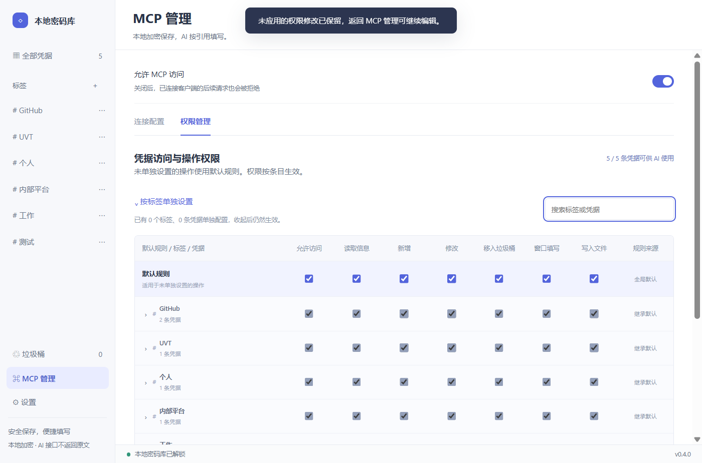

# 0.5.5 distribution and update verification

- CI compatibility: SHA-256 uses .NET directly so PowerShell 5.1 does not depend on Get-FileHash module discovery.
- Downloads: portable `vault-0.5.5.zip` and interactive `Vault-0.5.5-Setup.exe`; no standalone program EXE attachment.
- Installer: current-user NSIS, default `D:\Vault` (local application directory fallback without D:), editable directory, Start menu shortcut and uninstall registration. Reinstall and uninstall preserve the vault. In-use executables prevent replacement/removal.
- MCP server identity and generated configuration key: `Vault`. GitHub repository: `panda-student/Vault`.
- Schema 2 update feed signs the portable ZIP hash/size and the program hash/size. Rust reads only the fixed executable member, then the existing local helper performs replacement, health verification and rollback.
- **Users of 0.5.3 and earlier must manually upgrade once**, preserving the original Windows user, computer and complete data directory.
- Local verification: 48 Rust tests; 27 native signed ZIP update/rollback checks with two retained MCP connections; installer wizard directory editing and data-preserving reinstall/uninstall. Final installed-artifact regression runs in CI before publishing.
- Dependency notices regenerated: 324 components, no missing license texts. The ZIP reader uses the minimal DEFLATE feature; no bundled WebView2 or PowerShell extraction.
- Native update tests use isolated debug builds 0.5.4 -> 0.5.5 with a signed localhost source; they use isolated fixtures independently of the production release.

---

# 0.4.0 release verification

Windows x64 portable release, using the installed system WebView2 runtime. All acceptance data is synthetic and isolated from the user's vault.

## Changes

- Tags replace independent groups. Old groups become deduplicated, same-name tags in active and deleted records; old group API input remains a compatibility alias.
- MCP permission matrix: defaults first, expand tags in the same table, then expand a tag to edit individual credentials. Collapsing never revokes saved rules.
- Core evaluates each operation using entry override, then tag rules (deny wins conflicts), then defaults. Access and the individual operation must both be allowed. New vaults default to all permissions enabled; existing explicit settings are preserved.
- Search omits unauthorized objects; mixed-authority batch reads fail as a whole. Batch mutations authorize old/proposed scope against persisted settings inside the write transaction and roll back completely on failure. MCP cannot relabel an entry to escalate its permissions.
- Effective-permission previews use the Rust core. Object rules are encrypted. Tag rename/deletion updates rules, active records, deleted records and the catalog atomically. Unsaved UI permission drafts survive page navigation.
- Existing v1/v2 databases receive a consistent encrypted SQLite backup before v3 migration. Reopening does not repeat record-version changes. Secret values and other fields are preserved.
- Project license is Apache-2.0; dependency licenses and notices are retained separately.

## Validation

| Check | Result |
| --- | --- |
| Rust tests | 31 passed, including legacy upgrade, encrypted backup, conflicting labels, overrides and transactional denial |
| Rust Clippy | Passed with warnings treated as errors |
| Vue/TypeScript production build | Passed |
| Live stdio permission checks | 38 passed, including same-connection revocation and scoped batch rollback |
| MCP / desktop integration | 21 passed |
| Native release WebView2 suite | 122 passed, including real hit targets, checkbox persistence and native window resizing |
| Interactive debug WebView2 + live MCP | 25 passed, including tag rename/delete, hidden-rule enforcement, shared entry overrides and draft retention |
| Legacy executable migration | 6 passed |
| Native Notepad / PowerShell ISE / file writes | 20 passed, including independent saved-file comparison and one-use target replay rejection |
| Portable ZIP extraction | Distribution-only files, Apache license/NOTICE, SHA-256 verified; extracted EXE reran desktop/MCP and native editor acceptance |

The packaged executable's hash is the same hash recorded by the release integration and package tests. No real credentials or user database were used in these tests or included in the package.

## Size and hashes

- EXE: **5,603,840 bytes** (5.60 MB).
- Complete extracted package: **6,475,608 bytes**, including notices and required third-party sources.
- ZIP: **2,812,319 bytes** (2.81 MB).
- EXE SHA-256: `58085a0cb6717397c3d96b253ae6c1e4562fdb1d3218f6d4c2dcba43826be6d7`.
- ZIP SHA-256: `68dc2ae3c4d196d40616f3b954e8aa0ea4d35c7d1f538b1f7a1e60093e0a9485`.

## Screenshots

Only synthetic fixture data is shown.

## Upgrade

Use the existing complete `data` directory or start the new executable with `--data-dir` pointing at it. The package intentionally contains no user database. Before the first schema upgrade, the app creates `data/backups/before-tags-permissions-*.db`. Keep this backup if you need to restore the old version; older executables do not support v3 databases. Update MCP clients to the new executable and reconnect.

## Verification boundary

Tests ran on this Windows account and machine. The 25 interactive checks used a debug WebView2 attached to the local development UI; the separate 122-check suite and native editor checks ran on the production and extracted package executables. Another Windows account, an OS sign-in cycle, a machine without WebView2 and every external control/browser were not tested. This is not an independent security audit.
